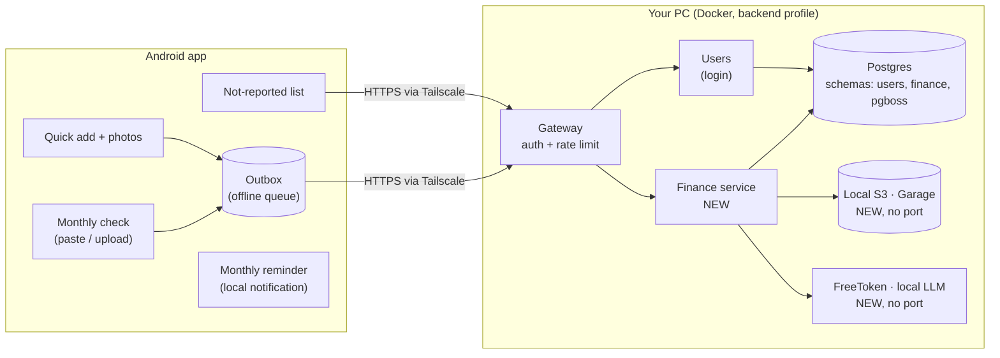
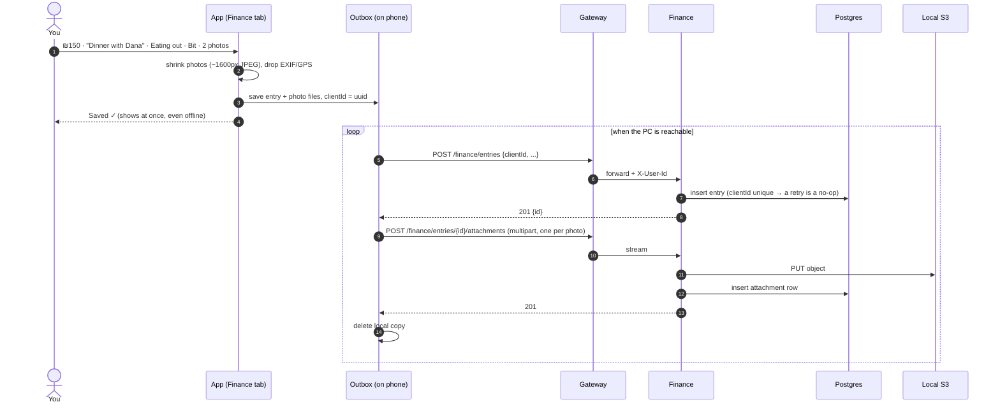
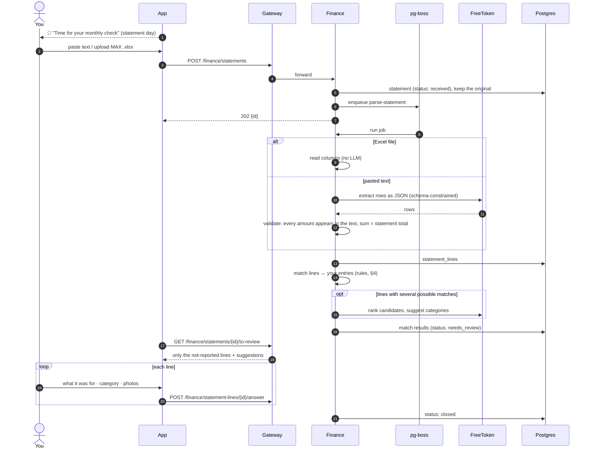
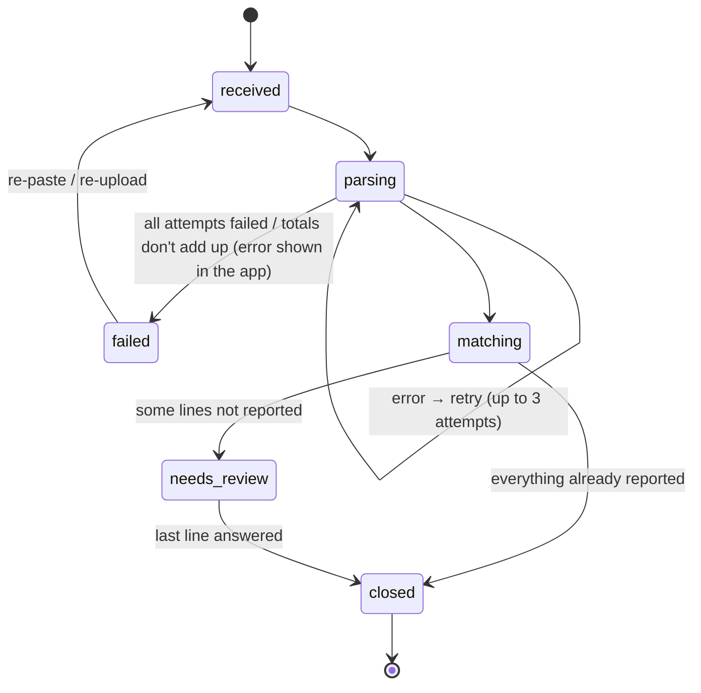
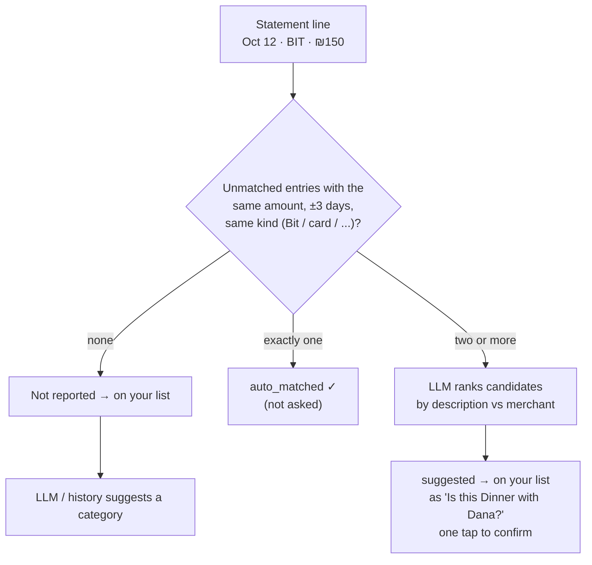
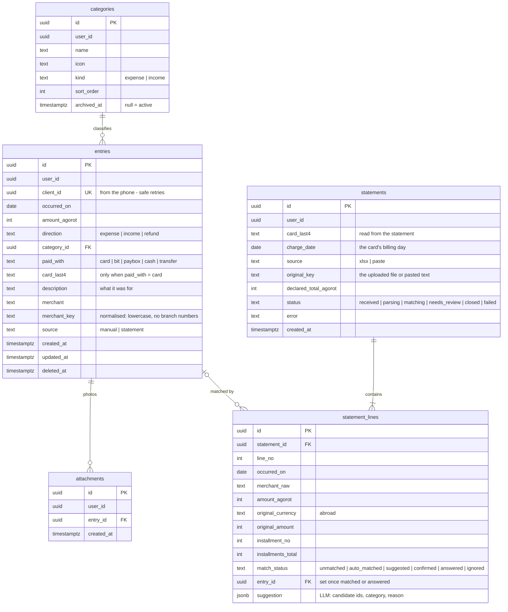
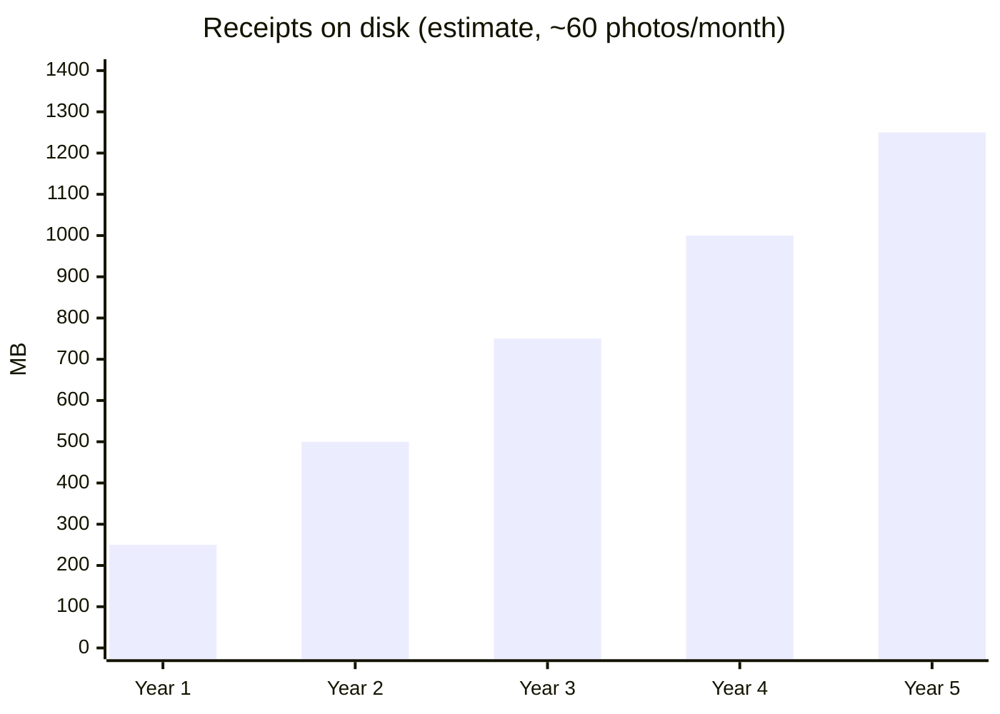

# Finance — the design

Asked 2026-10-27. The design: flows, services, tables, API, storage and LLM choices. The stages,
tasks, decisions and open questions are in [`plan.md`](plan.md); the screens in
the design canvas linked at the top of the plan.

## Goal

1. **Daily quick add.** The day something happens — a Bit transfer, cash, a grocery run — register
   it: amount, what it was for, category, how it was paid, and **any number of photos** (receipts).
2. **The monthly check.** A reminder on statement day → paste or upload the month's card statement
   → the server matches it against what was already reported → **a list of only the charges not yet
   reported**, each answered with what it was for (+ photos). Empty list = month closed.
3. **Saved forever.** All finance data lives on the server, so it survives reinstalling the app or
   changing phones. Nothing goes to the cloud. No backups (decided 2026-10-27).
4. **A local LLM (via FreeToken)** helps read pasted statements and suggests matches and
   categories. It never decides on its own that a charge was already reported.

Out of scope for now: card notifications, budgets, savings/debts, pension, Excel export (the
earlier mockup's other screens) — each can be a later plan.

---

## 1. System overview

Hard rules carried over from CLAUDE.md: the phone talks **only to Gateway**; `finance`, `freetoken`
and Postgres get **no published port**; Gateway stays on `127.0.0.1` behind `tailscale serve`.

## 2. Services

| Service | New? | What it owns | Why it exists |
|---|---|---|---|
| **gateway** | existing | New `/finance/*` rows in `PROXY_ROUTES`, all `auth: 'user'`; **streaming pass-through** for uploads and image downloads | The only door from outside. Today's proxy (`service-http.client.ts`, axios) forwards JSON bodies only — multipart uploads and binary responses need a streaming path with a size cap |
| **users** | existing | Login, tokens | Finance data must belong to someone. Login becomes live **for the Finance tab only**; Home and Calendar stay login-free |
| **finance** | **new** | Schema `finance`, the receipts folder, statement parsing, matching, the not-reported list, monthly summaries, calls to the LLM | One service for one domain. Same hexagonal layering as Users (`api/ application/ infrastructure/ models/ entities/`) |
| **freetoken** | **new** (infra container, like Postgres — or on the host, see §8) | The local LLM (an MoE model) | Runs the LLM on the PC so statements never leave it. Reached only by `finance` over the Docker network |
| **s3** (Garage) | **new** (infra container, like Postgres) | Receipt photos and uploaded statement files | A local S3 server on the PC (§7). Reached only by `finance`; no published port |

**Not** a separate "assistant" service for the LLM: `finance` calls FreeToken through a port
(`ILlmClient`, an OpenAI-compatible adapter), so the LLM stays an infrastructure detail that can be
swapped (another model, Ollama, llama.cpp) without touching the rest.

**Background jobs:** parsing + matching + LLM calls can take minutes on a CPU, so a statement
import is a job, not one long HTTP request. Recommended: **pg-boss** (a job queue stored in
Postgres, its own `pgboss` schema) — no Redis to add back (BullMQ/Redis were removed in the
Android-only refactor).

**Retries:** a failed job (the LLM is down or times out, the PC restarted mid-way, an unexpected
line) is tried again automatically — **3 attempts**, waiting longer each time (pg-boss's
`retryLimit` / `retryDelay` / `retryBackoff`). Only when all attempts fail does the statement go to
`failed`, and the app shows **the error** ("Couldn't reach the LLM", "The rows add up to ₪7,612 but
the statement says ₪7,840"). A check that fails on the content itself — totals don't add up,
unreadable file — fails at once: retrying the same text gives the same answer.

## 3. Main flows

### 3.1 Daily quick add (with photos, works offline)

### 3.2 The monthly check

### 3.3 A statement's life

## 4. Matching: what the code decides, what the LLM may only suggest

If the LLM wrongly says "already reported", that charge is **never asked about** and its meaning is
lost without anyone noticing. So the rule is: **when unsure, ask.**

- **Kind** comes from the line: `BIT` / `ביט` → Bit, `PAYBOX` → PayBox, otherwise card. A card
  line only matches entries with the statement's `card_last4`.
- **±3 days** because a charge's date on the statement can lag the day you reported it. Tune after
  the first real months.
- **Installments (תשלומים):** each statement line is one payment. A manual entry of a 12-payment
  purchase matches the line whose installment number is 1 (or the first one seen); later payments
  link to the same purchase automatically. Open question — see `plan.md`.
- **Refunds** are lines with negative amounts; they match a refund entry or go on the list.

**Pasted-text safety checks** (an 8B model can invent or mistype a number):
1. JSON-schema output (`response_format`, if FreeToken honours it — §8) — the reply must be valid
   rows; `finance` validates the shape either way.
2. Every amount in the reply must appear literally in the pasted text.
3. The rows must add up to the statement total (you confirm the total on screen).
4. Any failure → the statement goes to `failed` with what didn't add up — never silently "fixed".

## 5. Tables (schema `finance`)

Money is **whole agorot** (`integer`), never floats. Dates of spending are `date` in Israel time
(`ISRAEL_TIME_ZONE`). `user_id` is the Users service's id **without a foreign key** — each service
writes only its own schema (CLAUDE.md).

- **Answering a not-reported line creates an entry** (`source = 'statement'`) and links it, so after
  a month is closed every line points to exactly one entry, and every entry is "what it was for".
- **Category suggestions without the LLM:** the category of your latest entry with the same
  `merchant_key` (one indexed query on `entries`). No separate rules table — it can't drift from
  your entries, and changing a category is picked up next time automatically.
- **`attachments`** holds only which photos belong to which entry. Size, type and checksum come
  from S3 itself (`HEAD` on the object). The object's key is built from the ids —
  `<user_id>/<entry_id>/<attachment_id>.jpg` — so no key column is needed. The row is kept (instead
  of listing the S3 folder) so an entry list can show "2 photos" and check the owner without a call
  to S3 per entry.
- **No table for LLM calls.** Debugging a bad suggestion uses the logs and traces the observability
  stack already collects; the suggestion itself is kept on the line (`statement_lines.suggestion`).
- Default categories are seeded per user on first use; you can rename, add and archive.
- pg-boss keeps its jobs in its own `pgboss` schema.
- **No cards table.** How something was paid is two plain fields (`paid_with`, `card_last4`). A new
  card just shows up with new last 4 digits — no table, API or code change. If per-card settings on
  the server are ever wanted (a nickname, a billing day), a `cards` table can be added then and
  filled from the last-4 digits already stored. The monthly reminder's day per card is an app
  setting on the phone.

## 6. API (all through Gateway, all `auth: 'user'`)

| Method | Path | Purpose |
|---|---|---|
| `GET` | `/finance/entries?month=2026-10` | Entries of a month |
| `POST` | `/finance/entries` | Quick add (with `clientId`) |
| `PATCH` / `DELETE` | `/finance/entries/:id` | Edit / delete (soft) |
| `POST` | `/finance/entries/:id/attachments` | Upload one photo (multipart, **streamed**) |
| `GET` | `/finance/attachments/:id` | The photo (binary, **streamed**) |
| `DELETE` | `/finance/attachments/:id` | Remove a photo |
| `GET` / `POST` / `PATCH` | `/finance/categories[/:id]` | Categories |
| `POST` | `/finance/statements` | Paste (JSON) or upload (.xlsx) → `202 {id}` |
| `GET` | `/finance/statements/:id` | Status + counts (the app polls while parsing) |
| `GET` | `/finance/statements/:id/to-review` | **The not-reported list** |
| `POST` | `/finance/statement-lines/:id/answer` | What it was for → creates an entry |
| `POST` | `/finance/statement-lines/:id/confirm` | "Yes, that's my entry X" |
| `GET` | `/finance/summary?month=2026-10` | Totals per category for the tab's header |

## 7. Receipt storage — the options

Expected size: a phone photo shrunk to ~1600px JPEG is **~250–400 KB**. At ~60 photos a month
that's **~20 MB/month, ~250 MB/year** — small.

Decided 2026-10-27: **a local S3 server on the PC** (a container in the backend profile, no
published port). The options that run locally:

| Server | Good | Bad | Fit |
|---|---|---|---|
| **Garage** | Built for self-hosting on small machines. One small container, low RAM. Actively maintained, stable | One-time setup by command line (assign storage, create bucket and key). No web UI. No object versioning | ⭐ **Recommended** |
| **SeaweedFS** | One container (`weed server -s3`). Fast with many small files. Has a simple web file browser | More concepts to learn (master, volume, filer). Heavier configuration | Good alternative |
| **Versity S3 Gateway** (`versitygw`) | Stores each object as a normal file in a folder, so photos stay readable even without it. Tiny | Fewer features, smaller community | Good if you want plain files on disk |
| **RustFS** | MinIO-like, with a web console. Apache-2.0 licence | Young project (not 1.0 yet) — risky for data you want to keep | Maybe later |
| **MinIO** | Best known, most S3 features | Since 2025 its free edition lost its admin console and, reportedly, its free ready-made images (check current status). Heavier | Not now |
| **LocalStack** | — | A testing tool, not meant to keep real data | ✗ |

**Recommendation: Garage**, reached by `finance` through an interface — `IReceiptStorage`
(`put`, `get`, `head`, `delete`) in `finance`'s `infrastructure/interfaces/`, with an
`S3ReceiptStorage` adapter on the standard AWS S3 SDK. Every option above speaks S3, so switching
between them is configuration only.

How it fits the rules:
- The S3 server gets **no published port**, like Users and Postgres. The phone never talks to it:
  uploads and downloads go phone → Gateway → `finance` → S3. (S3 "presigned URLs", which let the
  phone talk to S3 directly, would need the S3 port reachable from outside — that breaks the
  Gateway-only rule, so they're not used.)
- The app shrinks photos and **strips EXIF** (photos carry your GPS location) before upload.
- `finance` checks the real file type (magic bytes, not the file name) and caps size (e.g. 10 MB)
  before the `PUT`. Size and type are then read back from S3 when needed — not stored in Postgres.
- Photos are only ever served through `GET /finance/attachments/:id`, which checks the owner.

## 8. The LLM

Decided 2026-10-27: **FreeToken** (Apache-2.0, `FlashML-org/FreeToken`). It's a local inference
server built for **mixture-of-experts (MoE)** models: most of the model stays in system RAM and only
the parts each word needs go to the GPU, so models bigger than the GPU's memory still run. It
serves an **OpenAI-compatible HTTP API** (`ft serve --model <path>`, port 1919 by default).

What that means for this plan:
- **The model is an MoE model, not Llama 3** (Llama 3 is not MoE) — e.g. the one in FreeToken's own
  quick start, Qwen3.6-35B-A3B. Bigger and better at reading messy text than Llama 3 8B.
- `finance` talks to it through `ILlmClient` with an **OpenAI-compatible adapter** — the same adapter
  would work against Ollama or llama.cpp's server later, so the choice stays swappable.
- **To verify in stage F13, before relying on it** (FreeToken is new; most write-ups are second-hand):
  1. Does it honour JSON-schema output (`response_format`)? If not, §4's checks still catch bad
     replies, just more often.
  2. Does it run in a Docker container with the GPU on this PC (Docker Desktop + WSL2)? If not, it
     runs on the host, `finance` reaches it at `host.docker.internal:1919`, and it must listen on
     `127.0.0.1` only — never on all interfaces.
  3. RAM: an MoE model this size needs a lot of system RAM; check what the PC has.

It's used only for: pasted text → rows, ranking candidate matches, suggesting categories. Prompts
include only the statement and your entry descriptions — no names, card numbers or ids beyond
what's needed. Because of §4's checks, a weak answer makes the check ask more questions, not lose
data.

## 9. The app side

- **Finance tab** (login required for this tab only): this month's total by category, a
  "N to review" banner when a statement is waiting, a + button for quick add.
- **Quick add sheet:** amount, what for, category (suggested from history), payment method, date
  (default today), photos (camera or gallery, several).
- **Monthly check:** paste box or file picker → "Reading your statement…" → the not-reported list.
- **Outbox:** a persisted queue (entries + photo files in the app's own storage) so quick add works
  with the PC off; each item retries until the server confirms. Follows the services-layer rule:
  all I/O in `src/features/finance/services/`, called from thunks.
- **Monthly reminder:** a local notification on the card's billing day, scheduled by the existing
  reminder machinery (a new reminder kind) — it holds no data, so it stays on the phone. Optional:
  a daily evening "anything to add today?".

## 10. What changes in the project

- The backend is **no longer dormant**: Gateway, Users, Finance, Postgres, Garage, FreeToken and the
  observability stack run all the time on the PC. CLAUDE.md, `docs/specs/` and the READMEs change
  to match.
- Gateway: streaming routes for uploads/downloads + a body size cap.
- `version/versions.json` gets a `finance` component.
- New docs: `docs/finance/environment.md` (every variable `finance` reads).
- Security at rest: turn on **BitLocker** on the PC's disk.
