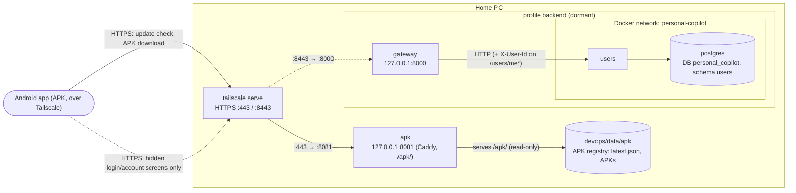
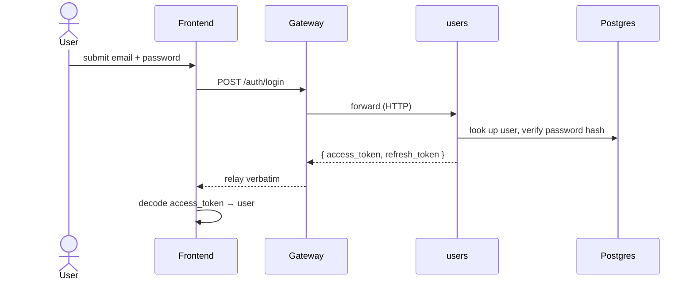
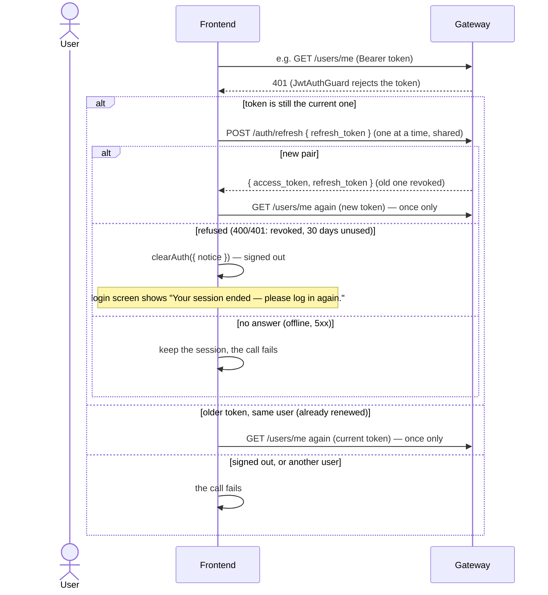
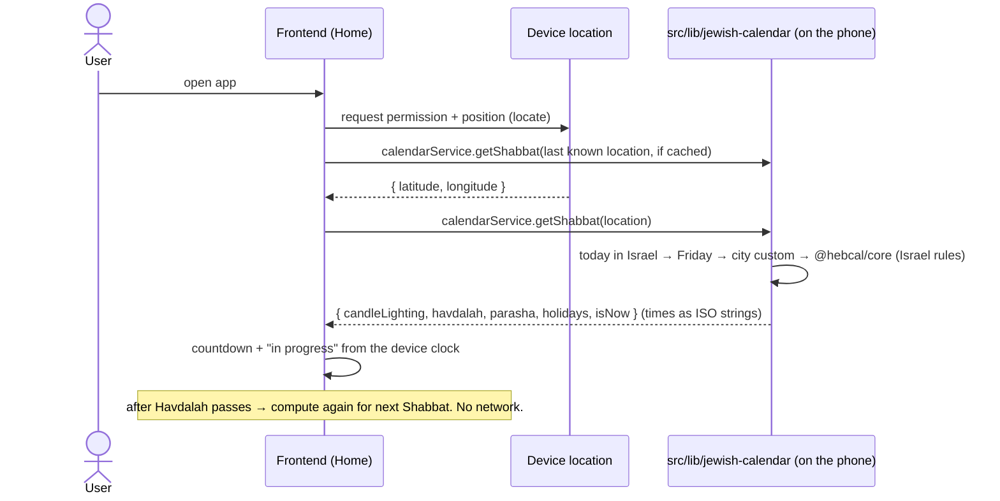
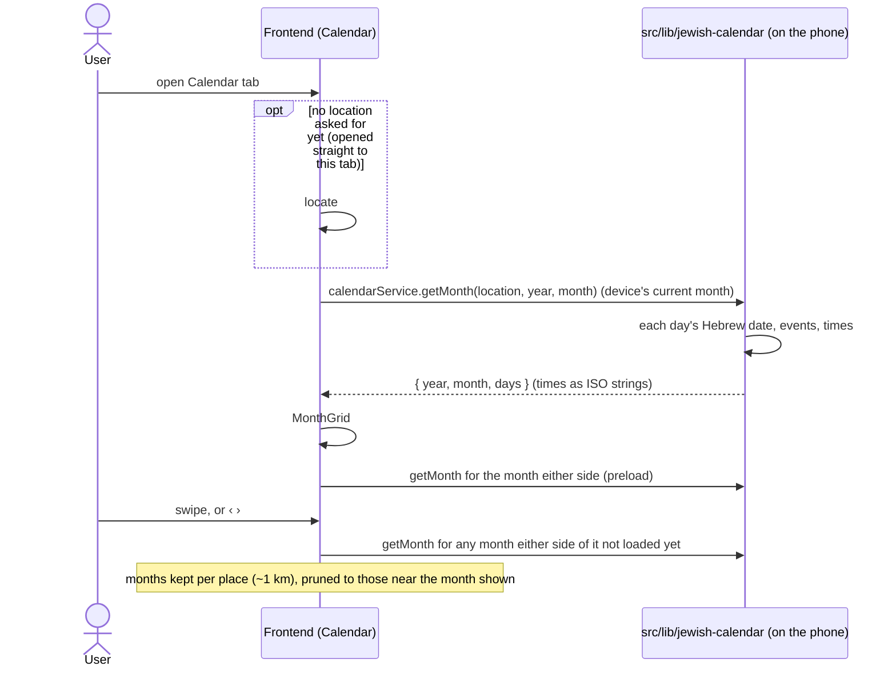
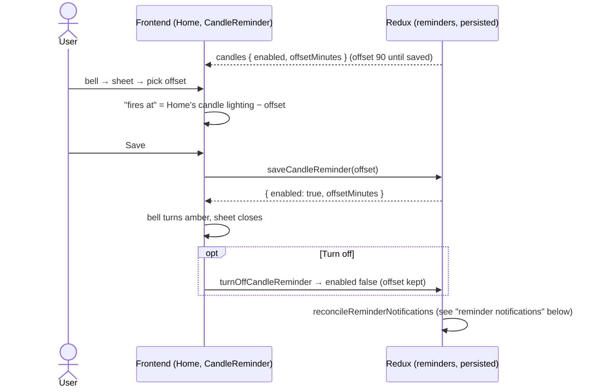
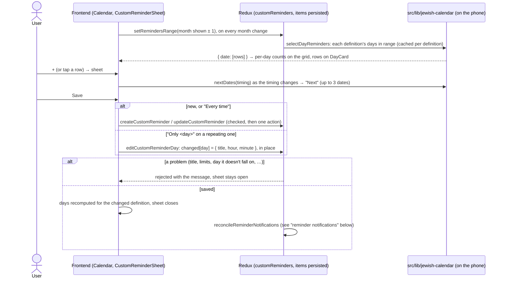
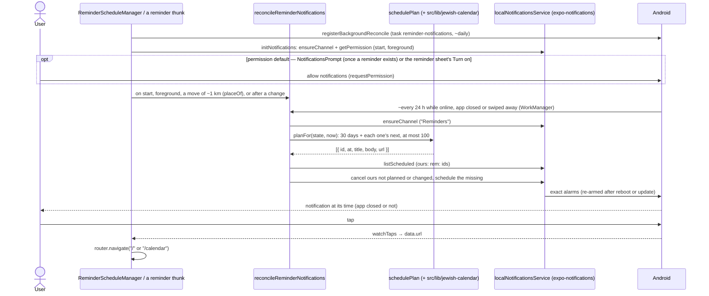
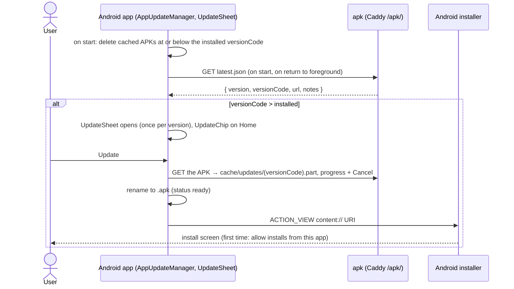

# Architecture

How the pieces in `docs/specs/services.md` fit together — diagrams plus the compose/build wiring
that doesn't fit one. See `services.md` for the per-service contract.

## System topology

The app needs no backend: it computes the calendar on the phone
(`frontend/src/lib/jewish-calendar/`), keeps its reminders there and fires them as local
notifications. What the PC serves it by default is `apk`, a Caddy container published on
`127.0.0.1:8081` serving the APK registry (`devops/data/apk`, written by `apk.js publish`) at
`/apk/` — the app checks it for updates and downloads new APKs from it. `tailscale serve`
(`devops/tailscale/serve.js`) puts it behind HTTPS with the machine's `*.ts.net` certificate,
`https://<pc>.ts.net/apk/` — Android blocks plain HTTP.

Dashed is dormant: `gateway`, `users`, `postgres` (and `postgres-init`) are
`profiles: ["backend"]`, started only by `docker compose --profile backend up -d --build`. Then
`tailscale serve` also forwards `:8443` to Gateway, the address the APK bakes in when
`GATEWAY_PUBLIC_URL` is set; only the hidden login/account screens call it. Gateway's `:8000` is
bound to `127.0.0.1`, so nothing reaches it without going through `tailscale serve`. `users` is
internal-only: accounts, tokens and profiles, behind Gateway's `/auth/*` and `/users/me*`.

Gateway rate-limits globally (`@nestjs/throttler`, `THROTTLE_TTL_MS`/`THROTTLE_LIMIT`) plus a
tighter per-route limit on `/auth/register`, `/auth/login`, `/auth/refresh` and `/auth/account`
(both methods; `AUTH_THROTTLE_TTL_MS`/`AUTH_THROTTLE_LIMIT`) — see `docs/specs/services.md#gateway`.
The limiter keys on client IP. Gateway's port is published on `127.0.0.1` only, so the only way in
is a local proxy — `tailscale serve` — which reaches the container through Docker's bridge, never as
the real client, and sets `X-Forwarded-For`. `src/trust-proxy.ts`'s `TRUST_PROXY` (loopback +
private networks) trusts exactly those hops (Express's `trust proxy`), so the limiter sees the
client's own IP. Nothing can reach the port from outside the machine to send a forged header —
that's what makes the trust safe, so the port must stay bound to `127.0.0.1`.

## Flow: register / login

## Flow: access token rejected (signed in)

Any signed-in call (only the dormant login/account screens make them); see `services.md#frontend`'s
"Staying signed in" and "Session ended". A call whose token has already expired renews before
sending, the same way.

## Flow: Shabbat times on Home

## Flow: month on the Calendar tab

## Flow: setting the candle-lighting reminder

Kept on the phone (`remindersSlice`, `candles` persisted) and fired as a local notification;
no network, no login. Planner and triggers: `services.md#frontend`'s "Reminder notifications".

## Flow: your own reminders on the Calendar tab

Kept on the phone (`customRemindersSlice`, `items` persisted); no network, no login. The sheet's choices:
`services.md#frontend`. Fired as local notifications, as in the candle-lighting flow.

## Flow: reminder notifications on the phone (Android)

## Flow: Android app update

No login, no Gateway. The registry is static files `apk`'s Caddy serves at `/apk/`, written by
`apk.js publish`.

## Compose & build layout

`devops/docker-compose.yml` only lists what to `include:` (one `devops/<unit>/docker-compose.yml`
per service — `apk`, `gateway`, `users`, `postgres` today) plus the shared `networks:`.
`docker compose up -d` starts only `apk`; the rest are `profiles: ["backend"]` and start with
`--profile backend`. Adding a backend service means a new Dockerfile under
`backend/apps/<service>/`, a new `devops/<service>/docker-compose.yml` (in the `backend` profile),
and one more `include:` line — see `.claude/agents/devops.md` for the full shape.

Restart policy, logging, and `env_file` live once in `devops/common.yml`'s `_defaults` service,
applied per-service via `extends:` (YAML anchors don't resolve across the split files, so that's not
an option here). `apk` extends it too, with `env_file: !reset []`: the registry needs no
`backend/.env`.
`networks:` stays out of `common.yml` and per-service instead, since the Nest services need
`[personal-copilot, observability]` (they export telemetry) while `postgres` needs just
`[personal-copilot]` and `apk` none (Compose's default network).
Two `env_file` layers apply to the backend services in order: `backend/.env` (local-dev defaults,
the shared base) then `devops/docker.env` (container-network overrides) — later entries win.

**Postgres**: one instance, one database (`personal_copilot`, `POSTGRES_DB`), one schema per
table-owning service. Every service connects with the same `DATABASE_URL` and sets its own
`schema`; it writes only that schema. `users` is the only backend app with tables.
`devops/postgres`'s `postgres-init` is a one-shot container that creates any missing schema on
every `up` (idempotent; Postgres's own first-boot init scripts can't, once `devops/data/postgres`
exists) — today `users`. Adding a service with tables = add its schema there.

`devops/docker-compose.yml`'s `observability` network is declared `external: true` — the telemetry
stack (`devops/observability/`) owns it and must already be running before `--profile backend`, or
that `up` fails outright ("network observability not found"). `apk` doesn't join it. See root
`CLAUDE.md`'s "First run".

**Android app**: built outside compose. `node devops/android/apk.js build` builds
`devops/android/Dockerfile` (JDK 17, Android SDK command-line tools, Node 22) and runs `apk.js`
itself inside it (`devops/android` mounted read-only at `/tools`) over a read-only `frontend/`
mount, with Docker volumes caching the SDK (`pc-android-sdk`), Gradle (`pc-android-gradle`) and
npm, and the release key plus the built APKs in `devops/data/android/`. It bakes in, as
`EXPO_PUBLIC_*` values Expo inlines into the bundle at build time: the `frontend` version from
`version/versions.json` (also Android's `versionCode`), the build time,
`GATEWAY_PUBLIC_URL` from `devops/.env` (optional, HTTPS when set) and the registry the app checks
for updates — `APK_REGISTRY_URL` (env or `devops/.env`), else
`https://<GATEWAY_PUBLIC_URL's host>/apk/`, `apk`'s address as `devops/tailscale/serve.js`
publishes it; it refuses to build when neither is set. arm64 by default
(`ANDROID_ABIS=arm64-v8a,x86_64` → an `-emulator` APK). `node devops/android/apk.js publish`
copies a built APK into `devops/data/apk/` — directly, or via a `node:22-alpine` container when that
folder is root-owned — which `apk` serves at `/apk/`.

**Phone smoke tests**: outside compose too. `node devops/maestro/smoke.js` builds
`devops/maestro/Dockerfile` (JRE 17, adb, the Maestro CLI) and keeps one container running for the
whole run — its adb server holds the phone, over USB (`/dev/bus/usb`, privileged) or
`--device <ip:port>` (wireless debugging). It mounts adb's key from the home folder (the one the phone
already trusts), `frontend/maestro/` read-only as the flows and `devops/data/maestro/` for the
screenshots, and drives the already-installed APK; it installs nothing but Maestro's helper apps.

**Version build context**: every backend image's `build:` adds
`additional_contexts: version: ../../version` — just the repo's `version/` folder, not the whole
repo as context. Each backend Dockerfile extracts only its own entry in a separate `own-version`
stage, so bumping one service's version leaves every other image's layers — and its baked-in build
time — cached. A standalone `docker build` must pass `--build-context version=../version`. What the
versions are and where they're shown: `services.md#versions`.
